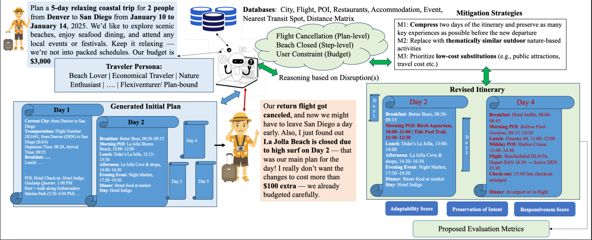

# TripTide: A Benchmark for Adaptive Travel Planning under Disruptions

<p align="center">
    <br>
</p>

## 📌 Overview

**TripTide** is a benchmark for evaluating the ability of Large Language Models (LLMs) to adapt travel itineraries in response to realistic disruptions. Unlike conventional travel-planning benchmarks that primarily assume disruption-free environments, TripTide focuses on how effectively LLMs revise existing travel plans while preserving user intent, personalization, and itinerary coherence.

TripTide extends the TripCraft dataset with realistic travel disruptions, structured annotations, and human-annotated revised itineraries. It evaluates model behavior under different disruption categories, severity levels, and traveler disruption-tolerance profiles.

The benchmark supports systematic analysis of how LLMs respond to unexpected events such as flight cancellations, accommodation problems, restaurant closures, attraction unavailability, and traveler fatigue.

**Paper:** *TripTide: A Benchmark for Adaptive Travel Planning under Disruptions*  
**Venue:** Findings of the Association for Computational Linguistics (ACL 2026)

## ✨ Key Features

- **Disruption-aware travel planning:** Evaluates itinerary revision instead of only generating an initial travel plan.
- **Multi-category disruptions:** Covers transportation, accommodation, restaurants, attractions, events/activities, and miscellaneous disruptions.
- **Multi-level severity:** Models step-level, day-level, and plan-level disruptions.
- **Traveler tolerance modeling:** Distinguishes between Flexi-Venturer and Plan-Bound travelers.
- **Structured annotations:** Provides disruption queries and human-annotated revised itineraries.
- **Comprehensive evaluation:** Measures preservation of intent, responsiveness, and semantic, spatial, and sequential adaptability.
- **Multi-model evaluation:** Reports results for GPT-4o, Qwen2.5-7B-Instruct, and Phi-4-mini-Instruct.
- **Human evaluation:** Complements automated metrics with expert assessment of revised itinerary quality.

## 📊 Dataset

TripTide contains **1,000 travel-planning instances** adapted from TripCraft, spanning three itinerary durations.

| Itinerary duration | Number of plans | Potential disruptions |
|---|---:|---:|
| 3-day | 344 | 2,489 |
| 5-day | 324 | 3,663 |
| 7-day | 332 | 4,906 |
| **Total** | **1,000** | **11,058** |

Each benchmark instance includes an original travel plan, disruption information, traveler information, and an annotated revised plan.

### Disruption categories

| Category | Examples |
|---|---|
| Transportation | Flight delays, cancellations, missed connections |
| Accommodation | Overbooking, poor hygiene, unsafe locations, missing amenities |
| Restaurant | Unexpected closures, long waits, limited dietary support |
| Attractions | Closures, ticket unavailability, weather-related restrictions |
| Event/Activity | Cancellations, rescheduling, venue changes |
| Miscellaneous | Fatigue, illness, jet lag, forgotten documents |

### Disruption severity

| Severity | Description |
|---|---|
| Step-level | Affects an individual activity or itinerary segment |
| Day-level | Impacts the activities scheduled for a particular day |
| Plan-level | Requires broader itinerary or route revisions |

### Traveler disruption tolerance

- **Flexi-Venturer:** More open to rerouting, substitutions, and changes to the original plan.
- **Plan-Bound:** Prefers minimal changes and strong adherence to the original itinerary, with the revision scope governed by disruption severity.

## 🧠 Task Definition

Given an original itinerary, traveler profile, disruption description, disruption severity, and disruption-tolerance level, the model must generate a revised itinerary that addresses the disruption while preserving the traveler's original goals and preferences.

The benchmark examines whether a model can:

1. Identify and respond appropriately to the disruption.
2. Make meaningful and contextually suitable itinerary changes.
3. Preserve the original travel intent and relevant constraints.
4. Maintain spatial and sequential coherence.
5. Avoid unnecessary changes to unaffected parts of the itinerary.

## 📏 Evaluation Metrics

TripTide evaluates revised itineraries along three main dimensions.

### 1. Preservation of Intent

Measures how well the revised itinerary retains the original travel objectives and constraints.

The paper reports:
- **Delivery Rate:** Whether the system produces a revised plan.
- **Commonsense Pass Rate (CPR):** Measures commonsense constraint satisfaction.
- **Hard Constraint Pass Rate (HCPR):** Measures hard-constraint satisfaction.
- **Final Pass Rate:** Measures the proportion of plans satisfying the evaluation requirements.

### 2. Responsiveness

Measures whether the model meaningfully addresses the specified disruption and proposes an appropriate intervention.

Higher responsiveness is preferred.

### 3. Adaptability

Measures the differences between the original and revised itineraries.

| Metric | What it measures | Preferred direction |
|---|---|---|
| Semantic Adaptability (\(A_{sem}\)) | Change in semantic or thematic alignment | Lower |
| Spatial Adaptability (\(A_{spa}\)) | Change in spatial convenience | Lower |
| Sequential Adaptability (\(A_{seq}\)) | Change in the ordering of points of interest | Lower |

The paper additionally evaluates generated itineraries using an LLM-as-a-Judge approach and a human expert study.

## 📈 Reported Results

The paper evaluates GPT-4o, Qwen2.5-7B-Instruct, and Phi-4-mini-Instruct on 3-day, 5-day, and 7-day itineraries.

Selected results from the automated evaluation are shown below.

| Model | Duration | Delivery Rate (%) | Final Pass Rate (%) |
|---|---|---:|---:|
| GPT-4o | 3-day | 100.00 | 29.37 |
| GPT-4o | 5-day | 99.69 | 41.98 |
| GPT-4o | 7-day | 100.00 | 32.54 |
| Qwen2.5-7B-Instruct | 3-day | 100.00 | 29.98 |
| Qwen2.5-7B-Instruct | 5-day | 100.00 | 29.12 |
| Qwen2.5-7B-Instruct | 7-day | 97.54 | 16.27 |
| Phi-4-mini-Instruct | 3-day | 45.23 | 18.26 |
| Phi-4-mini-Instruct | 5-day | 83.14 | 5.87 |
| Phi-4-mini-Instruct | 7-day | 100.00 | 3.06 |

These results illustrate that generating a revised itinerary does not necessarily guarantee constraint satisfaction. Performance also varies with model choice and itinerary duration.

For complete results, detailed analyses, LLM-as-a-Judge evaluation, and human evaluation, please refer to the paper.

## 🗂️ Repository Structure

The following is a suggested organization for the code repository. Update the structure to match the actual files committed to GitHub.

```text
TripTide/
├── README.md
├── requirements.txt
├── data/
│   └── README.md
├── prompts/
│   └── README.md
├── src/
│   ├── generate_revised_plan.py
│   └── evaluate.py
├── evaluation/
│   └── README.md
├── results/
│   └── README.md
├── paper/
│   └── README.md
└── LICENSE
```

**Note:** This is a suggested layout, not a claim about the current contents of the repository. Add the corresponding scripts and files before documenting them as available implementations.

## ⚙️ Installation

Clone the repository:

```bash
git clone https://github.com/YOUR-USERNAME/YOUR-REPOSITORY.git
cd YOUR-REPOSITORY
```

Create and activate a Python environment:

```bash
python -m venv .venv
```

On Linux or macOS:

```bash
source .venv/bin/activate
```

Install the dependencies after adding the project's actual `requirements.txt`:

```bash
pip install -r requirements.txt
```

The exact dependencies and environment configuration should be specified by the released implementation.

## 🚀 Usage

The intended workflow is to provide an original itinerary, traveler information, and disruption details to a planning model, generate a revised itinerary, and evaluate the resulting plan.

### Step 1: Prepare an input

An illustrative disruption record is shown below. Adapt the fields to the schema used by the released dataset and code.

```json
{
  "day": 2,
  "activity": "Lunch",
  "disrupted_entity": "South City Kitchen Midtown, Atlanta",
  "disruption_category": "Restaurant",
  "reason": "Reservation cancellation",
  "disruption_severity": "Step-level",
  "confidence": "Medium",
  "traveler_tolerance": "Plan-Bound"
}
```

### Step 2: Generate a revised itinerary

Use the original itinerary, traveler profile, disruption information, and the model prompt to generate a revised plan.

### Step 3: Evaluate the revision

Evaluate the generated itinerary using the benchmark's intent-preservation, responsiveness, and adaptability metrics.

**Implementation note:** The commands and executable scripts for these stages should be added once the corresponding source code is released. The example above illustrates the task and is not a verified executable command.

## 🧪 Experimental Setup

The paper reports experiments using:

- GPT-4o
- Qwen2.5-7B-Instruct
- Phi-4-mini-Instruct

The evaluation covers 3-day, 5-day, and 7-day itineraries. The experimental analysis includes automated constraint-based metrics, LLM-as-a-Judge evaluation using Llama-3.1-8B-Instruct, and human evaluation of revised plans.

The paper reports that three domain experts independently reviewed 100 revised itineraries sampled across the three itinerary durations.

## 📚 Citation

If you use TripTide in your research, please cite the following paper:

```bibtex
@inproceedings{karmakar2026triptide,
  title     = {TripTide: A Benchmark for Adaptive Travel Planning under Disruptions},
  author    = {Karmakar, Priyanshu and Chaudhuri, Soumyabrata and Mallick, Shubhojit and Gupta, Manish and Jana, Abhik and Ghosh, Shreya},
  booktitle = {Findings of the Association for Computational Linguistics: ACL 2026},
  pages     = {40269--40292},
  year      = {2026}
}
```

## 📄 Paper

**Title:** TripTide: A Benchmark for Adaptive Travel Planning under Disruptions

**Conference:** Findings of ACL 2026

**Paper:** [Read the paper on ACL Anthology](https://aclanthology.org/2026.findings-acl.2002/)

**PDF:** [Download the paper](https://aclanthology.org/2026.findings-acl.2002.pdf)

## 🙏 Acknowledgments

This work was partially supported by the TIH IIT Tirupati grant and the Microsoft Academic Partnership Grant (MAPG 2024), as acknowledged in the paper. We thank the annotators for their contributions to dataset curation and annotation.

## 📬 Contact

For questions about the research, please contact the paper's authors using the contact information provided in the paper.

## 📜 License

Please add the appropriate license after confirming the terms under which the source code and any distributable dataset components may be shared.
